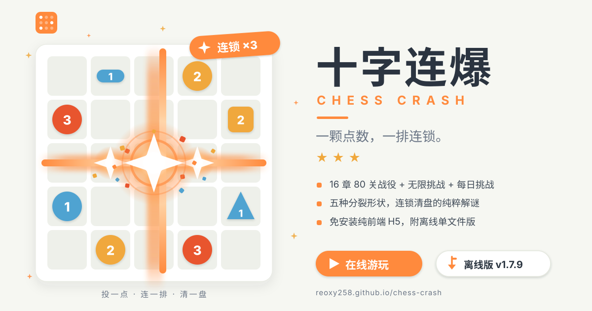

# 十字连爆 · Chess Crash — 作品信息

## 基本信息

| 项目 | 内容 |
|------|------|
| 作品名 | 十字连爆 |
| 英文名 | Chess Crash |
| 类型 | 休闲解谜（纯粹策略解谜，无时间压力、无随机） |
| 平台 | H5 网页游戏——浏览器即开即玩，免安装；桌面 / 平板 / 手机响应式（320px 起可玩） |
| 引擎/技术栈 | 纯原生 JavaScript + CSS + WebAudio（零框架、零依赖、零素材文件） |
| 版本 | v1.7.9 |
| 作者 | Reoxy258 |
| 代码仓库 | https://github.com/Reoxy258/chess-crash |
| 在线游玩 | https://reoxy258.github.io/chess-crash/ |
| 离线版下载 | https://github.com/Reoxy258/chess-crash/releases（单 HTML 文件，双击即玩，130 KB） |

## 一句话简介

一颗点数，一排连锁——点一下棋子给它 +1，满 4 分裂，冲击波按棋子形状扫过行/列，引爆一整排连锁，清空棋盘即胜。

## 玩法说明

- **核心循环**：手中点数有限（关卡「手牌」），每回合给一颗棋子 +1 点；棋子到 4 即分裂消失，并按自身形状给波及范围内的棋子各 +1；被波及的棋子再爆，一波接一波，连锁清空整块棋盘。
- **五种波及形状**：普通圆点（十字：整行 + 整列）、横线胶囊（整行）、竖线胶囊（整列）、朝向三角（整行/列 + 角朝方向半臂，T 字形）、方框（周围一圈 8 邻域）。特殊形状自第二章逐章登场，每章一个手法主题。
- **播种机制**（第六章解锁）：花 1 点在空格种下 1 点新棋子，接住冲击波——高手的补刀工具。
- **三星评级**：投点数 ≤ 最优（par）3 星、≤ par+1 得 2 星、通关 1 星；同一关卡布局永远固定，可以背板刷三星。

## 三种模式

| 模式 | 说明 |
|------|------|
| 战役 | 16 章 × 5 关 = 80 关，逐章教学 → 零容错深水区；每关一分钟量级，失败秒重开 |
| ♾ 无限挑战 | 一关接一关，棋盘 6×6 放大到 9×9、手牌逐步收紧到恰好等于最优；失败结算跑分（通过关数 / 累计投点 / 最大连锁 / 最佳纪录） |
| 📅 每日挑战 | 日期种子生成，同一天全站同款；难度按年内第几天轮换 7 档；星数取当天最佳 |

## 特色亮点

1. **零依赖纯前端**——无框架、无构建产物依赖、无任何素材文件（音效全部 WebAudio 程序合成），离线版整个游戏只有一个 130 KB 的 HTML 文件。
2. **演出即读谱**——激光刀按爆源形状开光路（十字四向全刀 / 单行一刀 / T 形刀阵 / 方框震荡波），玩家靠动画就能读出每一颗棋子的波及范围。
3. **求解器内建**——迭代加深搜索（置换表 + 可采纳下界剪枝）既把关全部 80 关的最优解（关卡生成时逐关验证 par），又驱动运行时两级免费提示（先按设计规则快解、再按实际播种规则兜底）与失败后的通关解回放。
4. **确定性关卡管线**——固定种子生成 + 逐关 solver 复验 + 章节约束（形状家族保底、播种章必含播种解），换种子即得一批全新关卡。
5. **打击感全套**——贯穿激光刀、命中爆闪、形状定向碎片、冲击波环、顿帧、三档震屏、连锁徽章、弹字评价、逐波倒计时；正确落位金环金勾 + 确认铃；三星彩带；连胜金色烟花庆典（三连胜建立后每一胜都庆祝）。
6. **无障碍与克制**——动效减弱（prefers-reduced-motion）全覆盖、一键静音持久化、点击不留焦点框、连锁动画可点击加速。
7. **质量护栏**——78 项自动测试（引擎规则 / 求解器 / 80 关全量复算 / 挑战生成 / 提示回放 / 界面流程 / 连胜节奏），GitHub Actions 测试 + 发布双工作流。
8. **异步安全**——换关/回菜单取消旧局回调与动画任务，答案演示全程输入锁定、离开即取消，挑战关卡生成成功后才提交进度。

## 规模与质量数据

| 指标 | 数值 |
|------|------|
| 关卡 | 16 章 × 5 关 = 80 关（另有无限 / 每日两种运行时生成模式） |
| 自动测试 | 78 项全绿（`npm test`） |
| 离线单文件 | 136 KB（全部资源内联，构建口径） |
| 代码规模 | engine / solver / levels / challenge / app 五模块 + 7 个测试文件 |
| 部署 | GitHub Pages，`main` 推送自动发布 |

## 运行与开发环境

- **玩家**：任意现代浏览器（Chrome / Edge / Safari / Firefox，桌面或移动），打开网页即玩；离线版双击 HTML 即玩。
- **开发**：Node.js ≥ 20，无需安装任何第三方依赖：
  - `npm start` 本地预览（http://127.0.0.1:4173/）
  - `npm test` 78 项自动测试
  - `npm run levels` 重新生成并验证 80 关（固定种子，可复现）
  - `npm run build:offline` 构建离线单文件版

## 相关文档

- [设计材料](设计材料.md)——玩法 / 视觉 / 音效 / 关卡 / 技术架构五份设计说明
- [README](../README.md)——完整规则、实现与 1.0.0–1.7.7 全部验证记录
