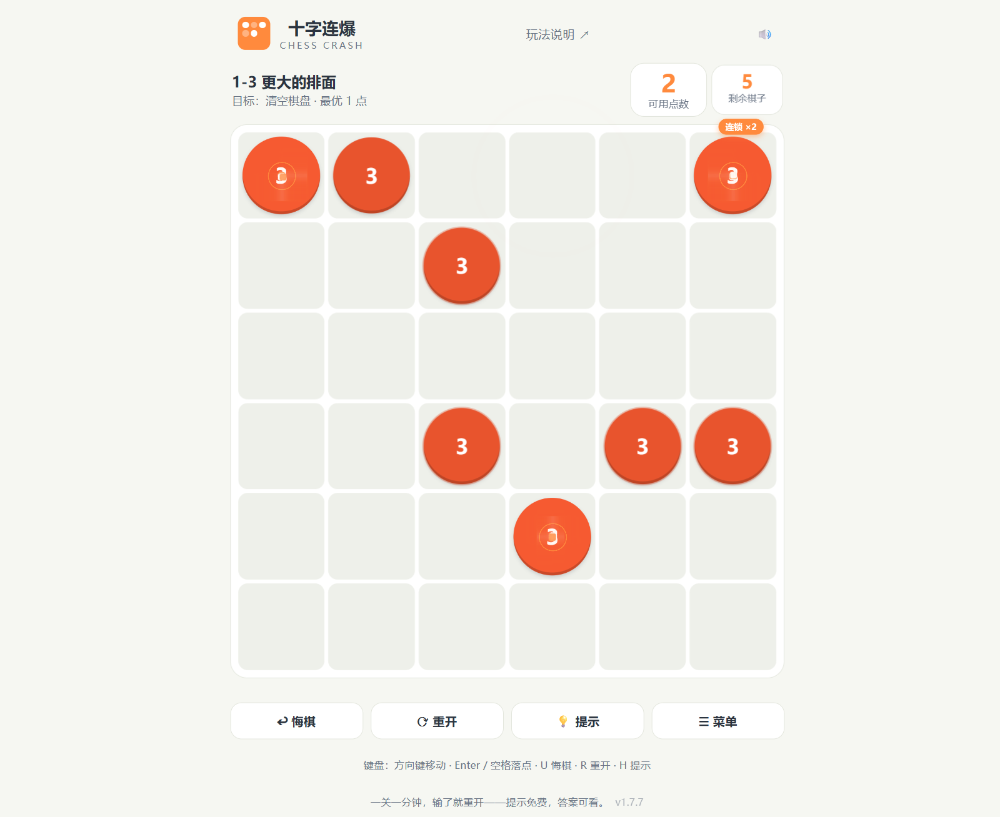

# 十字连爆 · Chess Crash — 设计材料

> 本文是作品的完整设计说明，覆盖玩法、视觉、音效、关卡与技术五部分。
> 游戏截图见 `docs/screenshots/`，封面见 `docs/cover.svg`。

| 截图 | 内容 |
|------|------|
|  | 主菜单：章节卡片 + 无限/每日挑战入口 |
|  | 局内演出：贯穿激光刀 + 连锁爆闪 |
|  | 胜利结算：星级 / 战绩 / 彩带 |

---

## 一、玩法设计

### 1.1 概念：把「连锁反应」做成可计算的谜题

设计关键词：**确定性、可回溯、一手一世界**。

- 每关是一块固定棋盘（无道具、无随机），玩家手中的点数（「手牌」）是唯一资源；
- 一颗棋子 +1 到 4 就分裂，冲击波按形状扩散——玩家的每一步都在「排布引爆顺序」；
- 目标是用尽量少的投点清空棋盘——**最少投点数（par）由求解器算出**，作为三星线。

它同时满足两类动机：休闲玩家「每关一分钟、输了秒重开」的短循环，和硬核玩家「逐关三星、背板优化」的长循环。

### 1.2 规则内核（引擎级，测试以此为基准）

- 稳定棋盘每格 1–3 点；每回合给一颗棋子 +1（或播种空格）；
- **同一波次**内达到 4 的棋子同时分裂：分裂者先行移除、互不加成；存活者可叠吃多道波，超过 4 点同样整颗消失；
- 棋子数单调递减、空格不自动生棋 → 连锁必然终止（终止性有随机 400 局对照测试）；
- 五种波及形状：

| 形状 | 视觉 | 分裂时波及 |
|------|------|-----------|
| 普通 | 圆点 | 同一横行 + 纵列（十字） |
| 横线 ▬ | 横胶囊 | 同一横行 |
| 竖线 ▮ | 竖胶囊 | 同一纵列 |
| 三角 ▲▼◀▶ | 朝向三角 | 整行/列 + 沿角朝方向的半臂（T 字形） |
| 方框 ■ | 圆角方块 | 周围一圈 8 邻域 |

### 1.3 难度资源：手牌、par 与播种

- **手牌收紧**是主难度轴：前期「手牌 = par + 2」随便玩，第九章起出现 **bank = par 的零容错关**（一步走错即死）；
- **播种**是第二资源轴：花 1 点在空格种 1 点新棋子「接住冲击波」——界面虚线只标「接波位」（任一存活棋子波及范围内的空格）；求解器的播种候选自 v1.7.8 起覆盖全部合法空格。第六章教学，第七章起 69% 关卡可用，但 par 仍按无播种设计——播种只是玩家的额外工具；
- **星级**：≤ par 三星、≤ par+1 两星、通关一星。三星线即最优线，无折扣。

### 1.4 辅助系统：免费、分层、可回放

- **提示两级**：第一次点提示给文字建议（「找一颗 3 点棋子」这类），第二次直接高亮具体落点；提示免费、不扣星。求解策略「设计规则优先、实际播种规则兜底」（受限搜索的 null 不是实际无解证明，未找到必须按真实规则补算），两级预算（450ms 快解 → 6s 深算），无解 / 算不动各有明确文案，换关即取消——绝不静默失败；
- **悔棋随便用**——试错零成本（配合确定性布局，「悔棋 + 重试」就是学习循环）；
- **答案回放**：失败后可看 par 步通关解自动演示，全程锁定输入（步骤间不可落子/重开）、离开页面即取消且不弹过期面板，然后「布局不变，再来一次」——把背板学习做进产品；
- **正确落位反馈**：落子后若仍走三星路径，金环 + 金勾 + 确认铃即时正反馈（详见 2.4 / 3.3）。

### 1.5 模式设计：三循环互补

| 模式 | 循环类型 | 设计意图 |
|------|---------|---------|
| 战役 80 关 | 背板重试 | 教学曲线 + 收集三星，固定布局供精研 |
| ♾ 无限挑战 | 跑分 | 运行时生成关卡，难度单调上升，失败即结算——考验「第一次见盘」的读谱能力 |
| 📅 每日挑战 | 日历社交 | 日期种子确定性，同一天全站同款，比拼当天最佳 |

战役重「学」，无限重「考」，每日重「晒」。

---

## 二、视觉设计

### 2.1 设计令牌（style.css `:root`）

| 令牌 | 值 | 用途 |
|------|-----|------|
| `--bg` | `#f6f7f2` | 页面底色（暖白纸感） |
| `--panel` | `#ffffff` | 面板 / 棋盘 / 卡片 |
| `--ink` / `--ink-soft` | `#2b3440` / `#6b7686` | 主文字 / 次级文字 |
| `--line` | `#e3e6dd` | 描边分隔 |
| `--accent` | `#ff8a3d` | 品牌橙：按钮 / 激光 / 徽章 / 焦点 |
| `--p1` / `--p2` / `--p3` | `#4fa3d1` / `#f0a83c` / `#e8542d` | 棋子 1/2/3 点 |
| `--good` / `--bad` | `#3aa76d` / `#d6553f` | 成功 / 失败 |
| `--radius` | `14px` | 全局圆角 |

### 2.2 棋子：点数即色温，形状即轮廓

两套编码正交，**不用看数字也能读盘**：

- **点数 → 色温**：1 蓝（冷静）→ 2 琥珀（升温）→ 3 赤红（预警）；
- **形状 → 波及轮廓**：圆点 / 胶囊 / 三角（四朝向）/ 圆角方——棋子长什么样，爆炸就扫什么范围。

预警的层次设计：p3 普通棋子有红色扩散环心跳（1.8s）；p3 三角历经四版迭代（光环 → 贴形环 → 静态渐变 → **「升温呼吸」**：冷色三段渐变 `#ffd23f→#ff8a3d→#e8542d` 与热层 `#ff8a3d→#e8542d→#c9431f` 同形交叉淡入淡出），色彩连续变换、方向语义不变。

### 2.3 演出层次：动画是信息，不是装饰

**设计原则：每个波及范围都能被「看见」。** 分裂时按爆源形状开出真实光路：

| 演出 | 内容 | 节奏 |
|------|------|------|
| 贯穿激光刀 | 十字=整行+整列四向全刀、横/竖线=一刀贯穿、三角=T 形刀阵；白亮芯 + 双层辉光 + 刀尖亮点沿光路线性扫射，扫过即命中 | 充能 45ms → 每格 15ms 扫射 → 驻留 → 收细消散 |
| 方框震荡波 | 方形双环扩散扫过 8 邻域（与引擎切比雪夫格距同步），第二圈延迟 80ms 制造余波 | 贴棋盘裁剪不出界 |
| 命中爆闪 | 目标处十字星（亮核 + X 光芒，族色辉光） | 与 +1 弹起同步 |
| 形状定向碎片 | 横线沿行、竖线沿列、三角朝角、方框八向、普通米字；60% 族色 + 40% 白 | 波内分裂 >12 时每颗 7→4 片保帧率 |
| 冲击波环 | 分裂者中心扩散，形状族配色（方框为方形轮廓） | 随格自适应 |

**打击感三件套**（重波落地）：

- **顿帧**：70ms 微停 + 棋盘白闪——下一波爆得更响；
- **震屏三档**：连锁 ×2 / ×3-4 / ×5+ 位移与旋转递增；
- **弹字评价**：双消！/ 妙！/ 漂亮！（连锁 3-4 波）/ 史诗连锁！（5+）/ 神之一手！（单次点击累计消 6+），新评价顶替旧评价逐级升格；连锁徽章分档变色（×3-4 紫、×5+ 赤红发光）。

**奖励反馈**：

- **正确落位**：金环扩散（15px，比预警环宽一倍——奖励比警示醒目）+ 格心上浮金勾 ✓ + 确认铃；
- **三星彩带**：26 片五色纸屑；
- **三连胜庆典**：金框礼盒回弹入场 + 👑 浮动 + 视口 6 轮辐射烟花 + 礼赞音。

### 2.4 无障碍与克制

- `prefers-reduced-motion` 全覆盖：震屏 / 冲击波环 / 弹字 / 顿帧 / 碎片 / 彩带 / 烟花全禁或缩至最短脉冲；
- 点击不留焦点框（`pointerdown` 只更新逻辑光标，键盘导航才显示描边）——触屏观感干净；
- 连锁动画点击 / 空格加速——急性子玩家可以「快进」；
- 响应式 320px 起可玩，字号 clamp 自适应。

---

## 三、音效设计

### 3.1 全程序合成，零音频文件

所有音效由 WebAudio 即时合成（振荡器 + 噪声 + 包络），**整个游戏没有一个音频素材**——这是离线版 130 KB 的前提之一。母线挂 `DynamicsCompressor`（threshold -18 / knee 24 / ratio 6），多音叠加不爆音。

### 3.2 音色表

| 事件 | 合成 | 听感 |
|------|------|------|
| 分裂 boom | 三层：saw 谐波滑落 + sine kick 150→42Hz + 白噪声 lowpass 扫频 | 厚重「充能爆射」 |
| 激光 zap | saw 高频下滑 + square 泛音 | 电光 |
| 震荡波 pulse | 低频双音低鸣 | 低鸣余波 |
| 命中 hit | 双音（+五度） | 清脆点射 |
| 连锁阶梯 | 每波音高叠高两个八度 sparkle | 越连越高亢 |
| 多消喝彩 cheer | 大三度和弦；praise(t) 档位越高叠音越多 | 阶梯喝彩 |
| 结算 win | 上行琶音；连胜加八度冠音 + shimmer | 礼赞 |
| 落位确认铃 correct | 1318/1976/2637/3520 四铃 + 高频金粉闪（noise 7200→2600） | 「走对了」 |

### 3.3 声学指纹与静音

- correct 的 3520Hz（E7）与 7200 闪音为该音独有频率，可作自动化验证的声学指纹（测试用 `AudioParam.setValueAtTime` 探针对账）；
- 已知无害撞频：连胜冠音 988×2=1976 与 correct 第二铃同频（巧合，v1.6.0 起记录在案）；
- 右上角一键静音，持久化；动效减弱偏好只关动画、不静音（听觉通道保留）。

---

## 四、关卡设计

### 4.1 十六章主题曲线

| 章 | 主题 | 学什么 |
|---|------|--------|
| 一 | 认识分裂 | 单点引爆、连锁全清 |
| 二 | 直线初现 | 横线只扫整行、竖线只灌整列 |
| 三 | 三角锋芒 | 三角看朝向：整行/列 + 角朝方向的半臂 |
| 四 | 方阵内爆 | 方框只轰周围一圈 8 邻域 |
| 五 | 形状协奏 | 四类形状同场协奏 |
| 六 | 空降播种 | 播种教学：点空格接住冲击波 |
| 七 | 队形与对齐 | 十字路口、一字长蛇、锋线走廊 |
| 八 | 方阵风暴 | 方框加权：方框稳居第一大族 |
| 九 | 手紧进阶 | 零容错遇上全形状 |
| 十 | 大盘风暴 | 8×8 大军团作战 |
| 十一 | 播种大师 | 大盘播种，波网空洞里下子 |
| 十二 | 混沌终局 | 9×9 混战 |
| 十三 | 钢索行走 | 深水零容错 |
| 十四 | 万形齐发 | 特殊形状密度拉满 |
| 十五 | 方阵大师 | 九路方框加权 |
| 终章 | 万象归一 | 八十关的最后一爆 |

三条交织的曲线：**棋盘 6×6 → 9×9**、**手牌宽松 → 零容错**、**形状单一 → 全混战**。每章第一关直接开放（可跳章观光），章内通关前一关解锁下一关。

### 4.2 生成与验证管线（确定性关卡学）

    固定种子 → 按章节配方随机棋盘 → solver 求最优 → 匹配目标 par 与章节约束 → 收录

- solver 逐关验证：**最优解深度 === par**（IDDFS 保证最浅）；播种章（六、十一）最浅解必含播种步；混形关按显示家族各保底一颗；
- 换种子即得一批全新关卡（`npm run levels -- <seed>`）；玩家进度按关卡 id 存储；
- 挑战模式关卡在**运行时**即时生成 + solver 验证（mulberry32 确定性随机 + 难度曲线配方：6 起横竖线、10 起三角、14 起方框，随难度混入；未中扰动种子轮换兜底）。

### 4.3 par 语义（关键设计决策）

**par = 无播种最优**（播种章除外：par 含播种步）。第七章起开放播种只是给玩家的额外工具——熟练玩家偶尔能用播种比 par 更省点拿三星，属预期宽松；提示 / 答案回放 / 三星路径判定按「设计语义优先」求解（v1.7.7 发现：带播种搜索在 9×9 深关会分钟级爆炸，设计语义下全部亚秒级；v1.7.8 再补上兜底——受限搜索找不到解时按实际播种规则继续，不再误报无解）。

---

## 五、技术架构

### 5.1 模块（零依赖，浏览器 / Node 双格式）

| 文件 | 职责 |
|------|------|
| `engine.js` | 不可变状态、确定性规则、同步波次连锁、五类形状（`cells[i] = (kind << 5) \| points` 编码）、逐波 trace（含波源形状与距离，供演出） |
| `solver.js` | 迭代加深搜索：置换表（cells+bank 键）+ 可采纳下界剪枝（v1.7.8 修正：绝不高估所需点数；播种候选覆盖全部合法空格）+ 启发排序 + 时间预算（超时返回 `{timeout}`，异常中断） |
| `levels.js` | 80 关固定数据（生成器产物，勿手改） |
| `challenge.js` | 无限 / 每日挑战运行时生成器（双导出：浏览器 `CC_CHALLENGE` / Node require） |
| `app.js` | 交互、演出、音效、进度存档、三种模式流程分流 |
| `style.css` / `index.html` | 响应式界面与全部动效 |
| `tools/` | `generate-levels.cjs`（关卡生成）、`build-offline.cjs`（离线构建）、冒烟脚本 |
| `tests/` | 5 个测试文件，59 项断言 |

### 5.2 质量护栏

- `npm test`：引擎规则回归（五类形状波及、朝向、编码往返、终止性）、求解器回归（超时语义、下界单调、播种 BFS 对照）、80 关全量复算（结构 / par / 回放必胜 / 章节规则）、挑战生成回归（确定性、难度单调、同天同款）、提示与回放回归（两级预算必出着、12s 整解、中局可解、9-4 专项锚点）、**界面流程回归**（`tests/app.test.js`：最小 DOM + 可控计时器 harness，覆盖正常通关、换关、提示、答案演示、挑战生成失败与过期请求）；
- GitHub Actions 双工作流：Test（每 push）+ Publish（Pages 发布）；
- 发布流程：改码 → `node --check` → `npm test` → 离线构建 → 浏览器实测（DOM / 计算样式 / 音频探针）→ 零宽字符扫描 → commit + push → CI 双绿 → 线上核对。

### 5.3 离线构建

`tools/build-offline.cjs` 把五模块 + 样式内联成单个 `chess-crash.html`（130.2 KB）——双击即玩、无需网络、无控制台依赖，作为 Release 附件分发。

### 5.4 性能备忘（设计语义求解实测）

| 场景 | 耗时 |
|------|------|
| 初始局面（无播种章，设计语义） | ≤450ms（16-3 445ms、9-4 39ms） |
| 初始局面（播种章六/十一） | ≤2.6s（11-4 最重） |
| 在路径中局 | ~30ms |
| 提示两级预算 | 450ms 快解（设计语义优先）→ 6s 深算（含实际播种兜底） |
| 答案回放预算 | 12s（覆盖全部 80 关初始整解） |

带播种的深关搜索由可采纳下界约束（v1.7.8），运行时只在「设计语义找不到解」的兜底路径进入。

---

*版本对应：本文描述 v1.7.8。全部设计演进的逐版本记录（1.0.0–1.7.8，含每次浏览器实测细节）见 [README 验证记录](../README.md)。*
